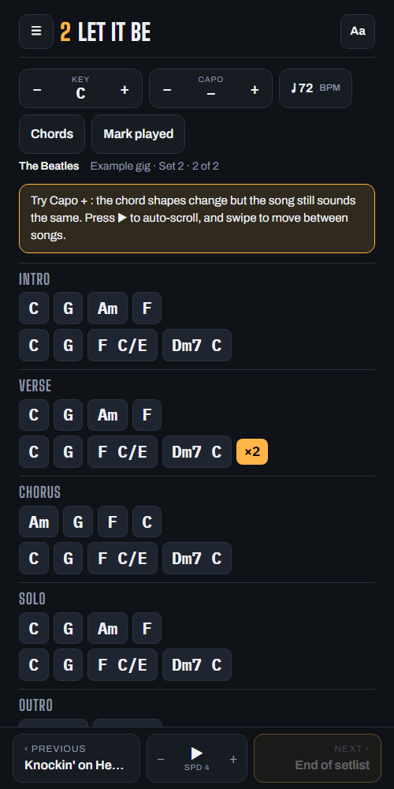
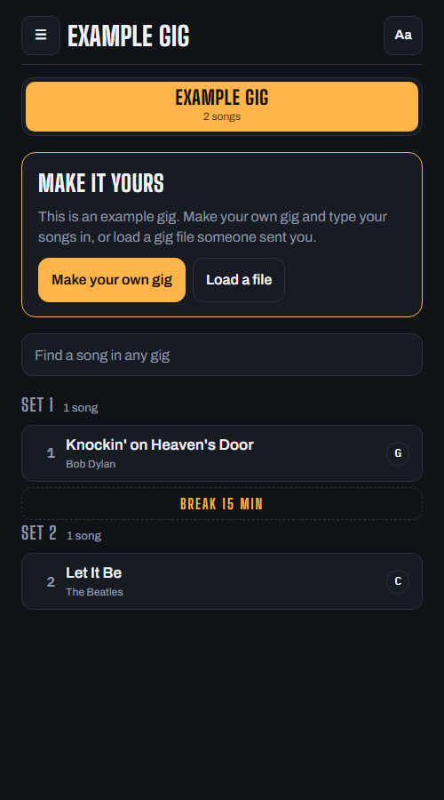

# Setlists

A chord app for playing gigs from your phone or tablet. Make a gig, type your songs in, and play from it on stage.

**Open it:** https://vibesbg.github.io/setlists/

 

## Use it for your band

1. Open the link. It starts with an example gig of two songs, so open them and try things out.
2. Tap **Make your own gig**, give it a name, and add your songs.
3. Type each song's chords (see below). Add sets and breaks, and put everything in order with ↑ ↓.
4. Add the app to your Home Screen. After the first visit it works without internet.

## Typing a song

Section name on its own line, chords separated by `|`, and `x2` at the end of a line to repeat it:

```
Verse
G | D | Am | C  x2
Chorus
C | G | D | D
```

## What it does

- Transpose the key, and a capo calculator that keeps the sound and changes the shapes
- Tap any chord to see how to play it
- Metronome with count-in and tap tempo
- Auto-scroll, swipe between songs, and works with a Bluetooth page-turner pedal
- Notes per song, mark songs as played, search across gigs
- Stage (dark) and Daylight looks, adjustable text size, keeps the screen on
- English and Bulgarian

## Your data

Everything you add stays on your own device. Nothing is sent anywhere. Use **Save gig to file** to keep a backup or send a gig to a bandmate, and **Load a file** to open one.

## For developers

One static page, no dependencies. `index.html` is built from `src/template.html`, `src/core.js` and `src/example.json`:

```
py -I src/build.py
```

Tests run in a browser: open `tests/core.test.html` directly, or serve the repo folder (`py -m http.server`) and open `tests/ui.test.html`.

---

Made by Dimitar Vasilev
